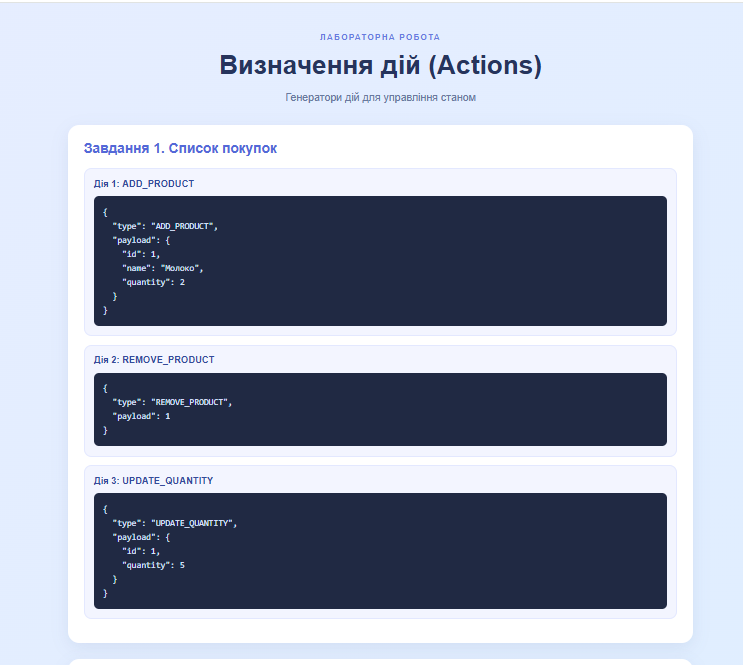
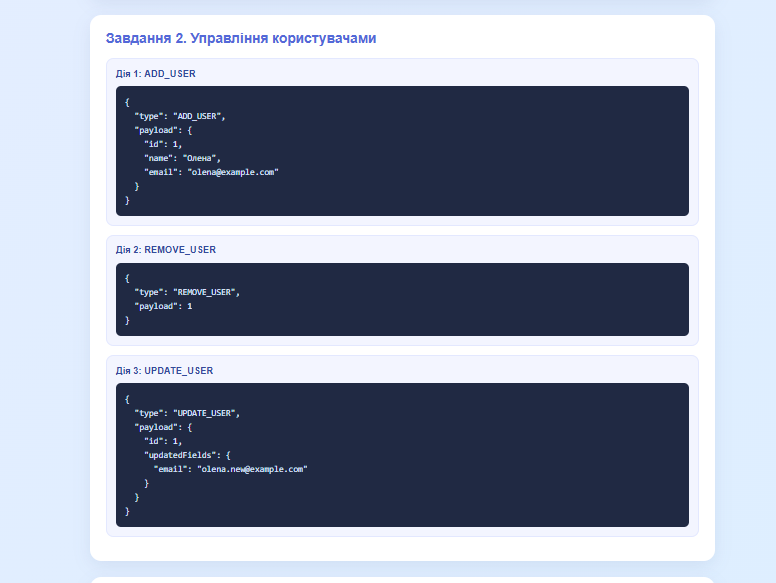
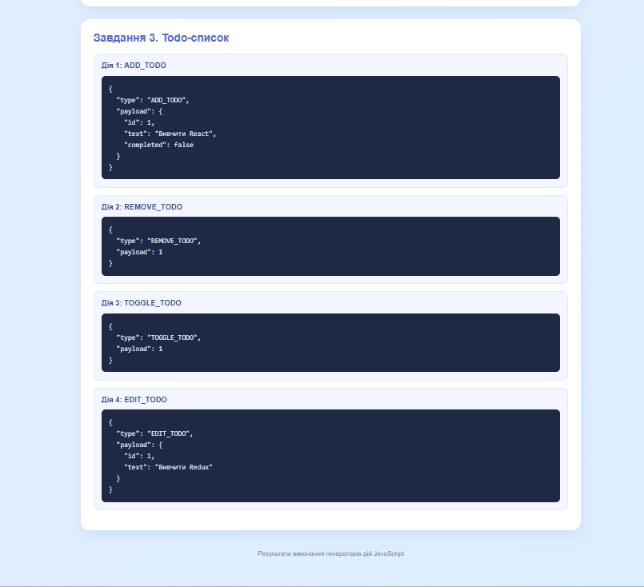

# Лабораторна робота: Визначення дій (Actions) для управління станом

## Мета роботи

Закріпити практичні знання з теми Actions, навчитися визначати типи дій та створювати генератори дій (action creators) для управління списками даних.

## Технології

- JavaScript (ES6+)
- Node.js
- Vite
- HTML5
- CSS3

## Опис роботи

Під час виконання лабораторної роботи створено генератори дій для трьох типів даних: списку покупок, користувачів та Todo-списку.

Для кожної дії сформовано об'єкт із властивостями `type` та `payload`.

### Завдання 1. Список покупок

Реалізовано такі дії:

- `ADD_PRODUCT` — додавання товару;
- `REMOVE_PRODUCT` — видалення товару;
- `UPDATE_QUANTITY` — оновлення кількості товару.

### Завдання 2. Управління користувачами

Реалізовано такі дії:

- `ADD_USER` — додавання користувача;
- `REMOVE_USER` — видалення користувача;
- `UPDATE_USER` — оновлення даних користувача.

### Завдання 3. Todo-список (додаткове)

Реалізовано такі дії:

- `ADD_TODO` — додавання завдання;
- `REMOVE_TODO` — видалення завдання;
- `TOGGLE_TODO` — зміна статусу виконання завдання;
- `EDIT_TODO` — редагування тексту завдання.

## Структура проєкту

```text
actions-practice/
├── public/
│   └── screenshots/
│       ├── 01-shopping-list.png
│       ├── 02-users.png
│       └── 03-todo-list.png
├── src/
│   ├── actions.js
│   ├── counter.js
│   ├── main.js
│   └── style.css
├── index.html
├── package.json
├── package-lock.json
└── README.md
```

## Запуск проєкту

Для встановлення залежностей виконайте команду:

```bash
npm install
```

Для запуску проєкту в режимі розробки:

```bash
npm run dev
```

Після запуску відкрийте адресу, яку покаже Vite, зазвичай:

`http://localhost:5173/`

## Результати виконання

### Завдання 1. Список покупок



### Завдання 2. Управління користувачами



### Завдання 3. Todo-список



## Висновок

Під час виконання лабораторної роботи було закріплено знання про дії (Actions) та генератори дій (Action Creators). Навчилася визначати константи типів дій, створювати об'єкти з властивостями `type` і `payload`, а також перевіряти результати їх виконання в консолі браузера та на вебсторінці.

У результаті роботи реалізовано генератори дій для списку покупок, користувачів та Todo-списку.
