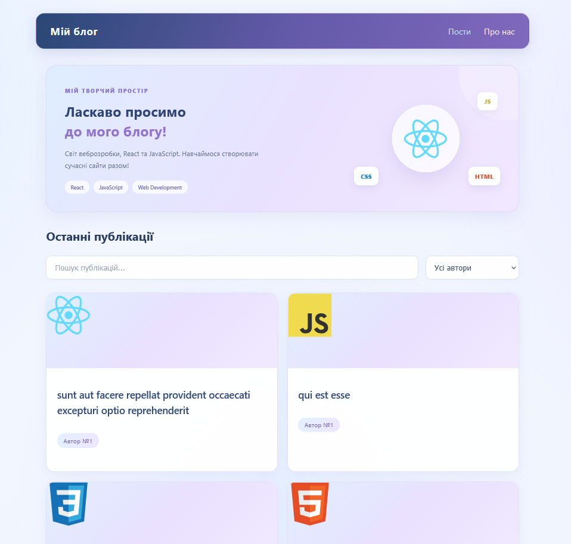

# 🌐 Мій блог — React Router Blog

Навчальний проєкт, створений у межах лабораторної роботи № 9.

## 🖼️ Попередній перегляд



## 📌 Опис проєкту

Вебзастосунок блогу, розроблений за допомогою React та React Router.

## 🛠️ Використані технології

- React
- JavaScript
- React Router
- Vite
- CSS
- JSONPlaceholder API

## ⚙️ Функціональні можливості

- Перегляд списку публікацій
- Перегляд окремої публікації
- Пошук публікацій
- Фільтрація за авторами
- Навігація між сторінками
- Обробка помилки 404
- Завантаження даних із зовнішнього API

## 🚀 Запуск проєкту

```bash
npm install
npm run dev
```

## 👩‍💻 Автор

Навчальний проєкт. 2026 рік.
