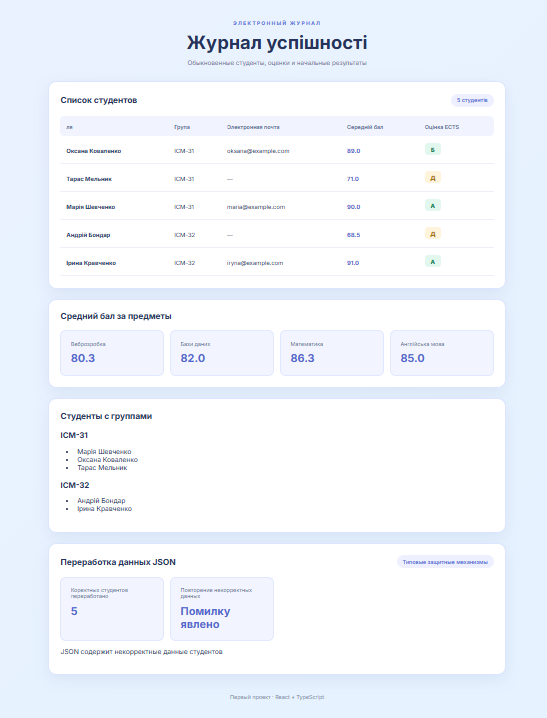

# Лабораторна робота: Електронний журнал успішності

## Мета роботи

Навчитися описувати моделі даних за допомогою TypeScript, використовувати Union Types, Discriminated Union, Generics, Utility Types, Type Guards та перевіряти дані невідомого типу.

## Технології

- TypeScript
- React
- Vite
- JavaScript (ES6+)
- HTML5
- CSS3

## Опис проєкту

Створено електронний журнал успішності студентів, який демонструє використання типізації TypeScript у React-застосунку.

У проєкті реалізовано:

- моделі студентів, оцінок та навчальних предметів;
- список студентів із двох навчальних груп;
- розрахунок середнього бала студентів;
- переведення числових результатів у систему ECTS;
- розрахунок середніх балів за предметами;
- групування студентів за навчальними групами;
- сортування студентів за іменем;
- перевірку структури даних за допомогою Type Guards;
- безпечне розбирання та перевірку JSON;
- обробку помилок і використання типу `unknown`.

## Структура проєкту

```text
ts-journal/
├── public/
├── screenshots/
├── src/
│   ├── data/
│   │   └── students.ts
│   ├── types/
│   │   ├── journal.ts
│   │   └── advanced.ts
│   ├── utils/
│   │   ├── grades.ts
│   │   ├── generics.ts
│   │   └── guards.ts
│   ├── App.tsx
│   ├── App.css
│   ├── index.css
│   └── main.tsx
├── index.html
├── package.json
├── tsconfig.json
└── README.md
```

## Основні можливості

### 1. Моделі даних

Створено типи `Student`, `Grade`, `Subject` та `EctsGrade`.

### 2. Utility Types

Використано `Pick`, `Omit`, `Partial` та `Readonly` для формування похідних типів.

### 3. Discriminated Union

Створено тип `JournalAction` для опису різних операцій із даними студентів та оцінками.

### 4. Generics

Реалізовано узагальнені функції `groupBy`, `getValues` та `sortBy`.

### 5. Type Guards та unknown

Реалізовано перевірки `isGrade`, `isStudent`, `isStudentArray` та безпечну функцію `parseStudents`.

## Запуск проєкту

Встановлення залежностей:

```bash
npm install
```

Запуск у режимі розробки:

```bash
npm run dev
```

Перевірка типів TypeScript:

```bash
npx tsc -b
```

## Результати роботи

На скриншоті представлено роботу електронного журналу успішності: список студентів, середні бали за предметами, групування студентів та перевірку JSON-даних.



## Висновок

Під час виконання лабораторної роботи було закріплено практичні навички роботи з TypeScript у React-застосунках. Створено типізовані моделі даних, використано Utility Types, Discriminated Union та Generics. Реалізовано групування і сортування студентів, розрахунок середніх балів, оцінювання за системою ECTS, а також перевірку та безпечну обробку JSON-даних за допомогою Type Guards і типу `unknown`.
